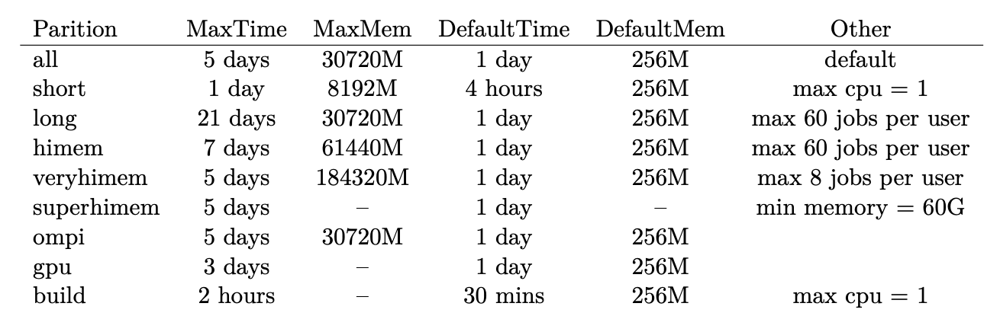

# Using the Computer Cluster

## What is a computer cluster?

A cluster is a set of networked computers and each computer represents one "node" of the cluster. When a user submits a job, Slurm will schedule this job on a node (or nodes) that meets the resource requested by the user. If no resources are currently available, the user’s job will wait in a queue until the resources they have requested become available for use.

Nodes are divided into distinct partitions (similar to queues in other scheduling systems) and a node may be part of multiple partitions. We have default resource limits for each partition. Please use the appropriate partition and request necessary resources based on your jobs or they may be killed by the scheduler because of exceeding the limits.

All users will have one or more Slurm usage accounts (usually their groups). Our cluster implements fair-share policy. Your job’s priority is determined by your group’s target usage, your account’s historical resource utilization, time that you job has stayed in the queue, partition that your job will be launched, and resources you request.

To access the cluster you need to run the following command in your terminal:

`ssh id@h4huhnlogin1.uhnresearch.ca`

This prompts you to use your passowrd to log in

### Interactive node

When you login you are on the login node. On the login node you have access to internet but you cannot run any jobs or navigate the cluster. To get into an interactive node you need to request access to a node with the following command:

`salloc -c 1 -t 10:0:0 --mem 2G`

## H4H and Mordor

In Pughlab we have access to two cluster systems, HPC4Health (H4H) and Mordor. Both systems use the slurm workload manager. Slurm is an open source, fault-tolerant, and highly scalable cluster management and job scheduling system for large and small Linux clusters.

H4H is a collection of servers where all data on the cluster is stored. There are many separate Isilon spaces that are used by the lab:

* `/cluster/projects/pughlab`
* `/cluster/projects/cgptip` is exclusively for CGPTIP related data. \*
* `/cluster/projects/ovgroup` is exclusively for OVGROUP related data. \*
* `/cluster/home/<username>` is your home directory on the cluster. You have a disk quota which, when reached, will prevent you from writing more data to disk. You will receive an email warning from IT when you begin to approach your quota (usually 50GB).

Our lab space (`/cluster/projects/pughlab`) is further broken down into the following directories: \
• `projects/` is used for projects (analysis, etc.)\
• `references/` is used for files that are to be accessible by all Pugh Lab users\
• `data/` is used to store internal data files (fastq or BAM)\
• `external_data/` is used to store external data files (ie, TCGA)\
\
Mordor has a similar structure where we have pughlab as the main group directory and there the following important subdirectories:

• `/mnt/work1/users/pughlab/projects`\
• `/mnt/work1/users/pughlab/data`\
• `/mnt/work1/users/pughlab/data_Miseq`\
• `/mnt/work1/users/pughlab/references`

### Using the cluster


Never run tools/scripts on the login node (h4huhnlogin2)!


#### Module System

There are many cluster users who want to use different software for different calculations in a high- performance computing environment – the cluster. Here comes the problem: software typically has dependencies – necessary programs and files must be present on a system before you can run say, R, or SVDetect (structural variation detection software). In parallel computing, using the same versions of each software across each node is essential. This is why we use environment modules to try to remove the effects of cluster heterogeneity. Modules are simply short scripts that typically set environment variables, which are flags or directory paths to programs (binaries) and libraries. These work on both cluster nodes and the head node.

All tools/software that you use on Mordor or H4H should be available in the module system. You can see and use modules by running the following commands:

**module avail** – List all available modules, a very long list.

**module load** – Load all of the modules listed. If a module name is given, the default version will be loaded, but a specific version can be loaded by following the module name with / and the desired version.

**module help** – How to use the module command

There may often be multiple versions for each tool (ie, samtools/0.1.18 and samtools/1.10); docu- menting which version is used is best practice for ensuring results are reproducible! If the tool you want to run doesn’t exist as a module, please contact IT: "RIS Helpdesk" \<helpdesk@uhnresearch.ca>

### Slurm

The cluster uses Slurm for cluster management and job scheduling. All information about Slurm can be found at its official web site https://slurm.schedmd.com/ . There are also lots of tutorials online.

Some basic slurm commands:

```bash
sinfo
sinfo -lN # same as above, but shows per-node status

squeue # This command is to show the status of jobs
squeue -l # long format

scancel # This command is to kill jobs
scancel <jobID> # kill job with <jobID>.
scancel -u <username> # kill all jobs for user <username>
scancel -t <state> # kill all jobs in state <state>. <state> can be PENDING,
   RUNNING, SUSPENDED

sshare # This command is to show Slurm share information
sshare -l # long format
```

### pughlab account on H4H

You can use an interactive mode to use higher level resources. Also you can use this account to submit high memory jobs to our private pughlab nodes.

salloc -c 1 -p pughlab -t 10:0:0 --mem 60G

sbatch -c 1 -p pughlab -t 10:0:0 --mem 60G job.sh&#x20;

#### Submitting jobs with sbatch

When submitting a job to the cluster with sbatch you can specify options either within your script, or as command line options. If given within the script, they must be at the beginning of the script and preceded by #SBATCH (as shown in the following example). If given on the command line, drop the #SBATCH and just use the option as usual.

```csharp
#!/bin/bash
#SBATCH -t 24:00:00
#SBATCH --mem 2G
#SBATCH -p all
#SBATCH -c 1

<commands to run>
```

Alternatively, you can provide the resource arguments from the command line:

```python
sbatch [options] <your job shell script>

# Where options are:
-c integer # number of cpus to use
-t 24:00:00 # time requested to run the job
--mem 2G # memory allocated for the job
-p <partition> # requested partition - defaults to ’all’
-N integer # number of nodes to use (only applicable on ompi partitionbas
```

### Partitions (Queues)

The partitions will be changed/added/removed when necessary. You can check the up-to-date par- tition list using “sinfo”. If you want to install software/download large reference files under your user space, you can use the “build” partition (this is the only partition with internet access).

<figure><figcaption></figcaption></figure>

### H4h and Valinor&#x20;

Module

Our cluster uses "module" to manage software and reference data. You can use

module avai # list all the available modules

module show \[\<module/version>] # show the details of the module

module load \<module/version> # load module for certain version of software or reference

module unload \<module/version> # remove the module settings from system

Data Transfer

We have data transfer node, h4huhndata1.uhnresearch.ca (172.27.23.173).

· If you are on the UHN network, you can connect to this data transfer node directly (I.e. using FileZilla)

· If you are on the open network (Internet), you can use scp on the login node to transfer file to your local machine. If the files are under your group directory, you have to copy them first to your home directory. You only have 50G under your home, so if you want to transfer huge files, please contact us. There is no internet on the compute nodes.

&#x20;If you need to transfer data between h4h and our valinor cluster

o From mordor:

`ssh valinordata1`

`scp my_file h4huhndata1:/cluster/project/your_group_directory`

`exit`

&#x20;From h4h:

`ssh h4huhndata1`

`scp my_file valinordata1:/mnt/work1/users/my_group_directory`

`exit`

### Tips

Your home directory is under /cluster/home/ and you have 50GB quota. Please only store config- uration files under your home and clean up often, otherwise it will be full quickly and your jobs may fail if they need to write into your home.

Your group directory will be under /cluster/projects. You should use your group directory as working directory. Different groups will have different quota. Please contact us if you need more space. It always a good idea to clean up your un-necessary intermediate files and large log files. Your group directory is not mounted on the login node (h4huhnlogin2), but it is available on all the compute nodes. You can use one of the compute nodes (or the data transfer node) to access your group directory (for example, an interactive session).

Our compute nodes have limited local storage, so please set up your own TMPDIR, TMP and TEMP variables. If you use system default /tmp, you may fill up the system local storage quickly and make everyone face the “no space on device” error on the same node.
