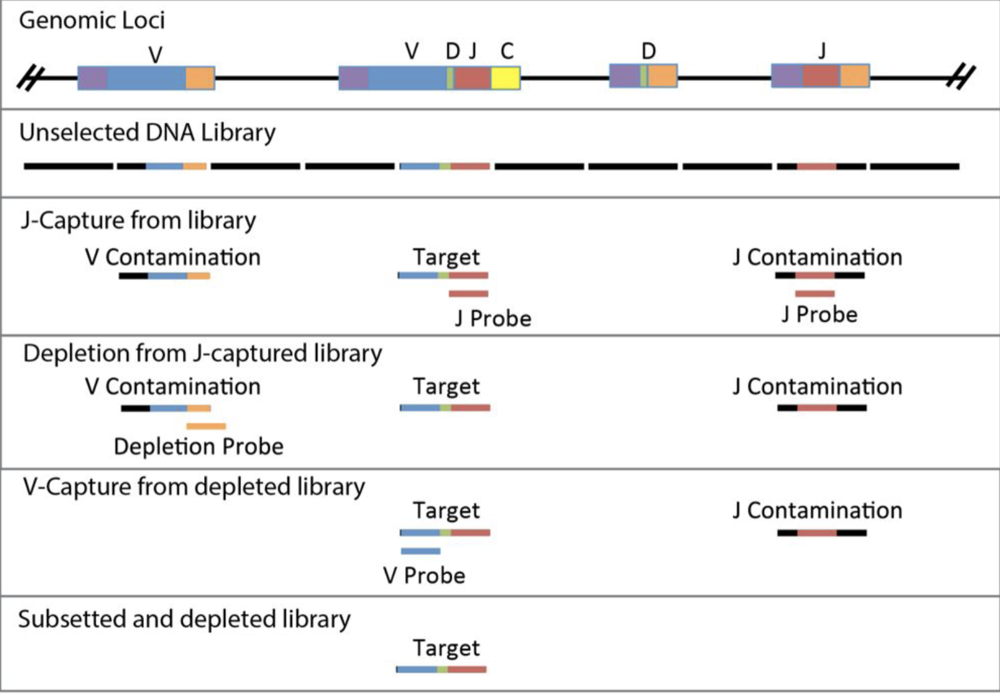

# Immune Profiling pipelines

## Immune Profiling Pipelines

## CapTCR-seq: hybrid capture for T-cell receptor repertoire profiling

&#x20;

[CapTCR-seq](https://ashpublications.org/bloodadvances/article/2/23/3506/16133/CapTCR-seq-hybrid-capture-for-T-cell-receptor) allows for rapid, high-throughput and flexible characterization of dominant clones within TCR repertoire that will facilitate quantitative analysis of patient samples and enhance sensitivity of tumor surveillance over time.

### Cap-TCR Bioinformatics pipeline

1. Barcode Extraction

The barcode extraction for this step is exact same as barcode extraction described in the UMI tools section of this manual.

1. MiXcr
2. QC plotter
3. Clone Tracking plotter
4. Diversity measures

The github repository for Cap-tcr bioinformatics pipeline is mainly captured in this repository:[https://github.com/pughlab/PLTK/tree/immunoprofiling](https://github.com/pughlab/PLTK/tree/immunoprofiling)

### Cap-IG

Cap-IG description

Bioinformatics Pipeline
